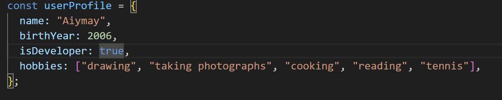
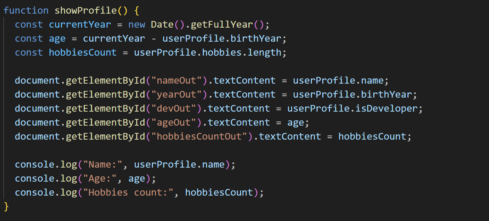
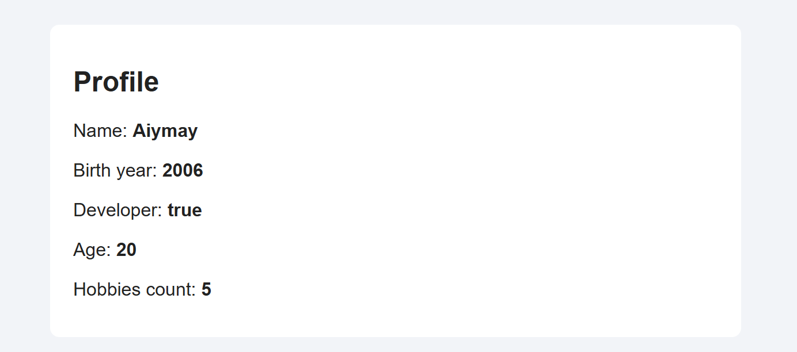
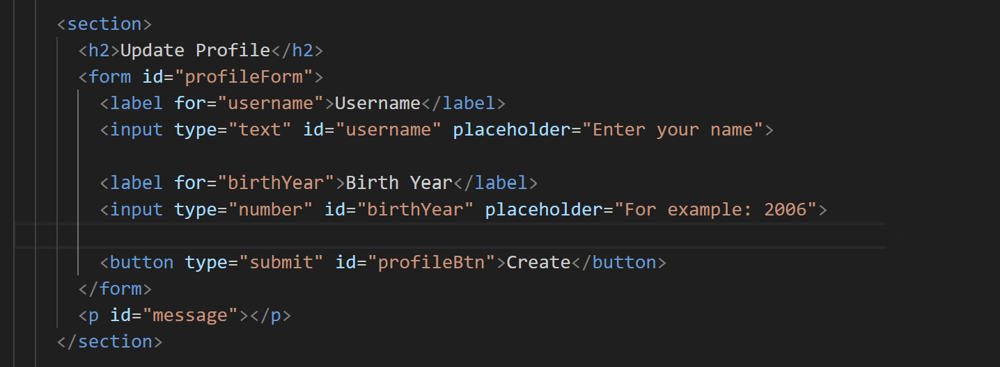
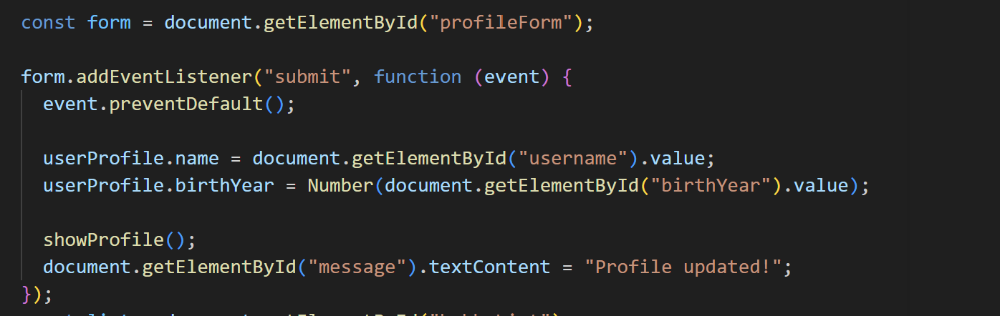
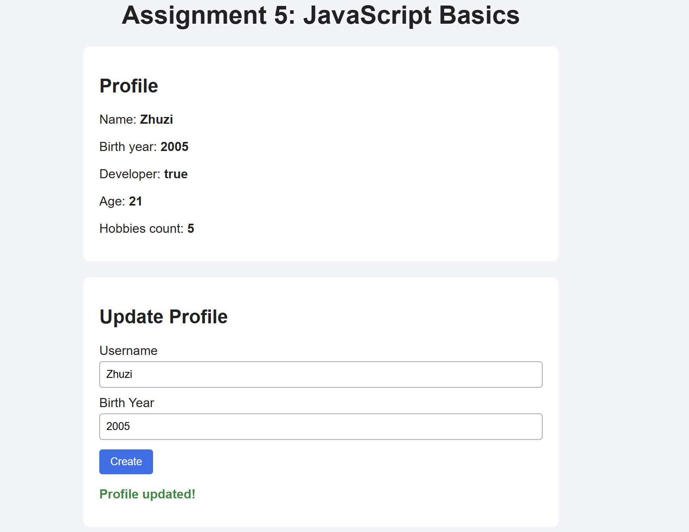
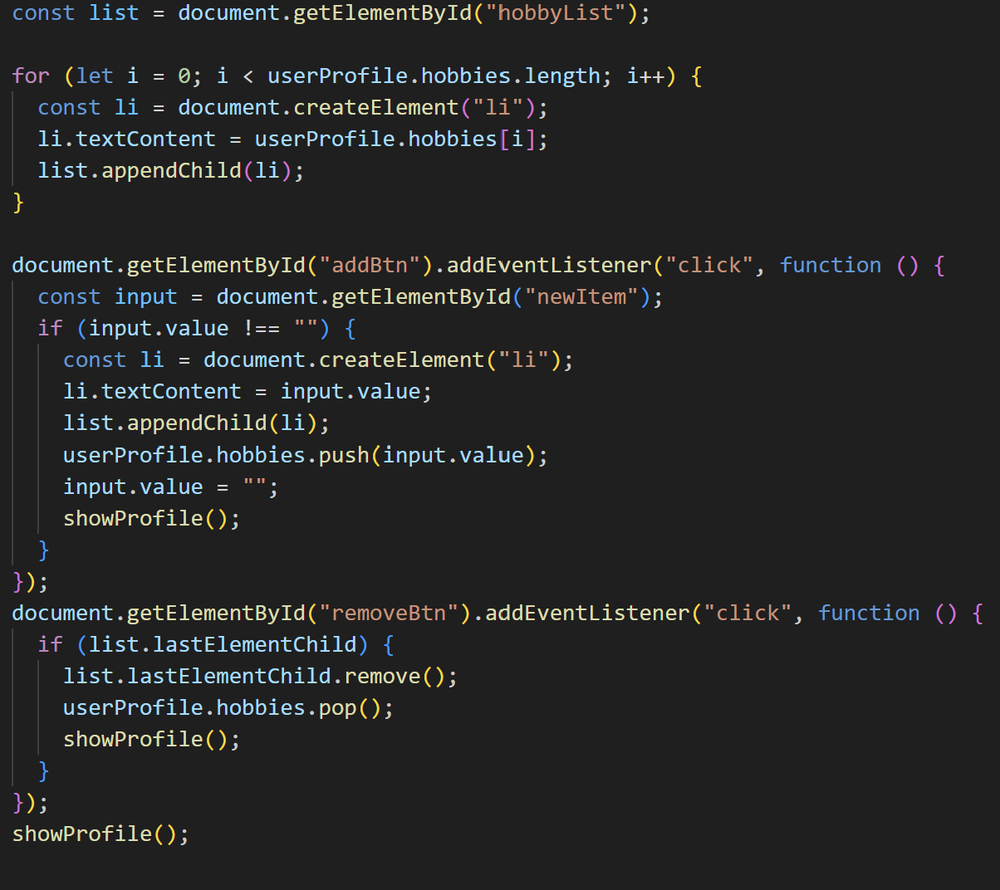
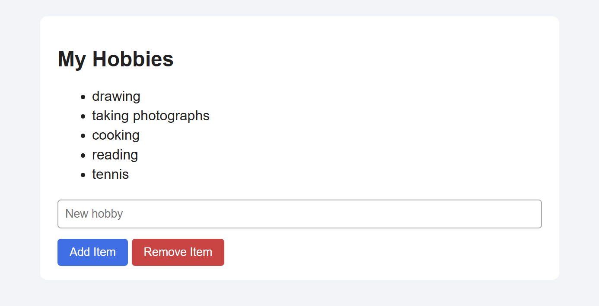

# Assignment 5. JavaScript Basics

**Name:** Aiymay Tleu

**Group:** SE-2539

---

## Part 1: Profile Object, Data Types & Arithmetic

### Task 1. The Personal Info Object
Create a `const` object `userProfile` with a string, a number, a boolean and an array.

I created the object `userProfile` in `script.js`. It has `name` (string), `birthYear` (number), `isDeveloper` (boolean) and `hobbies` (array).

### Task 2. Arithmetic Calculations
Calculate the age and one more metric. Show them in the console or on the page.

I calculated the age (current year - birth year) and the hobbies count (`hobbies.length`). The results are shown on the page and in the console.

---

## Part 2: Form Input & Event Responses

### Task 3. HTML Form Setup
Create a form with Username, Birth Year and a "Create / Update Profile" button.

I made a form in `index.html` with two inputs and a submit button.

### Task 4. Event Listener
Add an event listener to the button. Take the input values and update `userProfile`.

I added a `submit` event listener to the form. It takes the name and birth year from the inputs, updates `userProfile` and shows the new data on the page.

---

## Part 3: DOM List Manipulation

### Task 5. Creating & Removing Elements
Create a `<ul>` list, an "Add Item" button and a "Remove Item" button.

I made a `<ul>` with my hobbies. The "Add Item" button creates a new `<li>` and adds it to the list. The "Remove Item" button deletes the last `<li>`.

---

## Conclusion

In this assignment I learned the basics of JavaScript and how it works with a web page. I created an object with different data types (string, number, boolean and array) and used simple arithmetic to calculate the age and the number of hobbies. I also learned how to get values from a form, use the submit event and update the object with new data. Finally, I practiced DOM manipulation: I created new list items with createElement, added them with appendChild and removed them with remove(). This work helped me understand how JavaScript can change a web page when the user clicks a button or sends a form.
